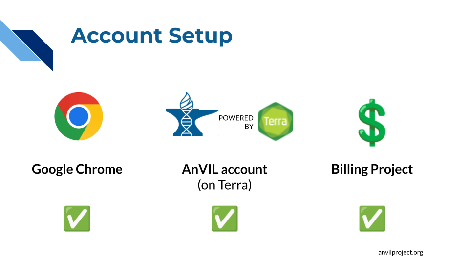

# Onboarding

Joining a team on AnVIL.

 

## Create Account

:::: {.borrowed_chunk}

1. ✅ AnVIL is supported by **Google Chrome**. If you don’t already have it, please [install Google Chrome](https://www.google.com/chrome/). If you already have it installed, make sure to [update Google Chrome](https://www.google.com/chrome/update/).

2. ✅ You must create an **AnVIL account**. AnVIL uses a platform called Terra to manage computing environments, so you will need to register through Terra.

    - [Set up a Terra account](https://support.terra.bio/hc/en-us/articles/360028235911-How-to-register-for-a-Terra-account) - You will need a Google account (either a gmail account or another email associated with a Google identity). *We recommend using your institutional email to set up your AnVIL account, because an institutional email is required to work with controlled-access data.*
    - **If your institution uses Google accounts** (e.g. gmail), you can simply log in to Terra using your institutional Google account.
    - **If your institution does not use Google accounts**, you can [create a Google identity linked to your institutional email](https://support.terra.bio/hc/en-us/articles/360029186611-Setting-up-a-Google-account-with-a-non-Google-email).

3. ✅ You will need access to a **Billing Project** in order to work on AnVIL.
    - If you will be attending a live AnVIL training event (such as the [virtual AnVIL 101 workshop](https://training.anvilproject.org/anvil101.html)), make sure to **provide your Google identity (i.e. e-mail address) when you register, or when prompted by the workshop instructor**, so that they can give you access to the workshop Billing Project. The AnVIL Training team will cover the costs of workshop activities.
    - If you will be working through the material on your own, you will need to [set up Billing](https://anvilproject.org/learn/get-started/setting-up-lab-accounts) yourself or **talk with the person in charge of your team’s Billing Project(s)** to get access to your team’s funding. If you are setting up billing yourself, note that, as of the time of writing, Google provides free credits to new users.
::::

### FAQs

This is split out as a separate child doc so that you can choose whether or not to include it

:::: {.borrowed_chunk}

1. **Can I use a regular gmail account (not associated with an institution)?**
    - A regular gmail account will be fine for workshops like AnVIL 101, but an institutional email is required to make use of certain AnVIL features, including most AnVIL datasets. To comply with [NIH data security requirements](https://support.terra.bio/hc/en-us/community/posts/35674059053211-New-NIH-external-identity-restrictions-for-NIH-controlled-access-data), unaffiliated email accounts (such as gmail.com) CANNOT be given access to controlled-access data. We recommend using an institutional account if possible. See this [Service Announcement](https://support.terra.bio/hc/en-us/articles/56479513867035-Service-Notification-Oct-7-2026-NIH-Researcher-Auth-Services-RAS) from Terra for more details about CADR-compliant email addresses.
2. **Why do I need a Billing Project?**
    - AnVIL and Terra are powered by Google Cloud Platform (GCP), and AnVIL users are responsible for the costs of the underlying cloud resources that they use, such as storage space and computing power. (AnVIL and Terra do not charge any additional fees, they just pass along GCP charges.) Billing Projects are how AnVIL and GCP know who to charge. If you do not have access to a Billing Project, you cannot run computations or store files on AnVIL. Note that, If you are attending a live workshop, this will be handled for you -  you will be given access to a Billing Project for the duration of the workshop to cover the costs of any workshop activities.
::::

## [old] Create Google Account

Note that this child doc is considered deprecated. Prefer `_child_create_account.Rmd` going forward.

::: {.warning}
#### Choose Your Account Type {-}

Do you plan to work with **controlled-access data** (e.g. GTEx, dbGaP)?

  - IF YES, **you MUST use an institutional email address**. To comply with [NIH data security requirements](https://support.terra.bio/hc/en-us/community/posts/35674059053211-New-NIH-external-identity-restrictions-for-NIH-controlled-access-data), unaffiliated email accounts (such as gmail.com) CANNOT be given access to controlled-access data.

Will you be **moving between institutions**?

  - IF YES, you might consider a gmail account. There is no way to transfer a Terra account to a new Google account (e.g. a new institutional email); you will have to add your new account to any projects you want to keep working on. So, if you are *not* going to be working with controlled-access data, it may be more convenient to use an unaffiliated gmail account.
:::

There are 2 ways to set up a Google account for use with Terra:

1. **Institutional Account**: use your institutional email
    - If your institution uses G Suite, you can sign into Terra directly using your institutional Google account.
    - If your institution does not use G Suite, you can create a Google account that is associated with your non-Google institutional email address by following [these instructions](https://support.terra.bio/hc/en-us/articles/360029186611).
1. **Unaffiliated Google Account**: use a personal account
    - If you have an existing Google account (such as gmail.com), you can use it to sign into Terra.
    - If you do not already have a Google account that you would like to use for accessing Terra, [create one now](https://accounts.google.com/SignUp).

